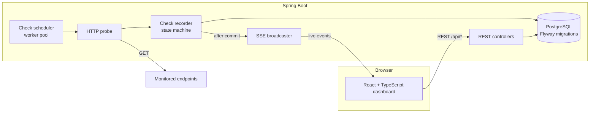
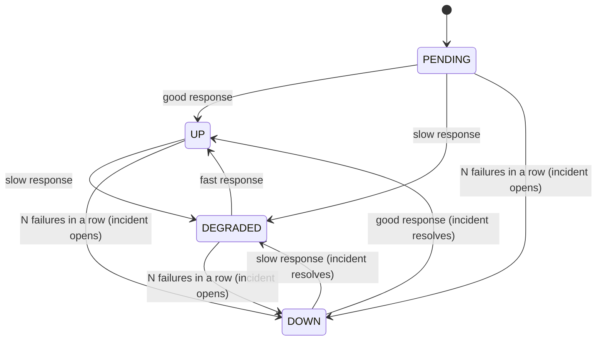

# PulseWatch

**A full-stack uptime and API health monitor.** Spring Boot checks your HTTP endpoints on a schedule, detects outages with a failure-threshold state machine, records incidents in PostgreSQL, and streams every change to a live React dashboard over Server-Sent Events.


<!-- Screenshot: run the app, then save a screenshot as docs/dashboard.png and uncomment the next line. -->
<!--  -->

## Features

- **Scheduled HTTP checks** on a worker pool, so one slow endpoint never delays the others. Each monitor has its own interval, expected status code and latency threshold.
- **Incident detection without false alarms.** A monitor is marked DOWN only after N failed checks in a row (default 3). The incident's start time is backdated to the first failure, and the first good check resolves it.
- **UP / SLOW / DOWN.** A correct but slow response counts as degraded, not down.
- **Live dashboard.** Status, latency and incidents update instantly through Server-Sent Events, with automatic reconnect and a polling fallback.
- **A hero drawn from live data.** The animated heartbeat at the top is generated from the latest check latencies of every monitor. It turns red the moment any service is down.
- **Latency analytics.** 24-hour uptime, p95 latency, a sparkline per monitor and a per-check latency chart.
- **Consistent API errors.** Validation, malformed-JSON and not-found errors all return RFC 9457 problem-details JSON. Validation errors include a message for each field, which the form shows inline.
- **Built-in demo services.** These include a healthy endpoint, a slow one and one with a 45-second outage every 3 minutes, so the app shows real incidents with no setup.
- **Tests and CI.** Backend unit tests and HTTP-level integration tests, frontend unit tests, and GitHub Actions running both on every push.

## Architecture



### How a check becomes an incident



The rules live in `StatusEvaluator`, a pure function with no I/O, so every transition is unit tested.

## Tech stack

| Layer | Technology |
|---|---|
| Backend | Java 17, Spring Boot 4, Spring Data JPA (Hibernate), Bean Validation, Flyway, Actuator |
| Database | PostgreSQL 16 (H2 in-memory for tests and quick demos) |
| Frontend | React 18, TypeScript (strict), Vite, hand-built SVG charts and CSS animations (no chart or animation library) |
| Testing | JUnit 5, AssertJ, Spring MockMvc, Vitest |
| CI | GitHub Actions (backend and frontend jobs) |

## Run it locally

You need **Java 17+** and **Node 20+**.

**1. Start the backend** (zero setup, in-memory database):

```bash
cd backend
./mvnw spring-boot:run -Dspring-boot.run.profiles=h2
```

**2. Start the dashboard** in a second terminal:

```bash
cd frontend
npm install
npm run dev
```

Open http://localhost:5173. Four demo monitors appear and start reporting within seconds. "Inventory API" goes down every three minutes, so you'll see an incident open and resolve.

### With PostgreSQL

```bash
docker compose up -d            # starts PostgreSQL on :5432
cd backend && ./mvnw spring-boot:run
```

The connection is configured with environment variables: `PULSEWATCH_DB_URL`, `PULSEWATCH_DB_USER` and `PULSEWATCH_DB_PASSWORD`. The defaults match `docker-compose.yml` and are for local development only.

## API

| Method | Path | Description |
|---|---|---|
| `GET` | `/api/monitors` | All monitors with 24h uptime, p95 latency and recent latencies |
| `POST` | `/api/monitors` | Create a monitor (`201 Created` with a `Location` header) |
| `GET` | `/api/monitors/{id}` | One monitor |
| `PUT` | `/api/monitors/{id}` | Update settings |
| `DELETE` | `/api/monitors/{id}` | Delete a monitor and its history (`204`) |
| `POST` | `/api/monitors/{id}/pause` and `/resume` | Stop or restart checks |
| `POST` | `/api/monitors/{id}/check` | Run a check immediately |
| `GET` | `/api/monitors/{id}/checks?limit=60` | Recent check results, newest first |
| `GET` | `/api/incidents?open=true` | Open incidents, or the 50 most recent |
| `GET` | `/api/stream` | Server-Sent Events: `monitor`, `monitor-deleted`, `incident` |
| `GET` | `/actuator/health` | Health check, including the database |

Create a monitor:

```bash
curl -i -X POST localhost:8080/api/monitors \
  -H 'Content-Type: application/json' \
  -d '{"name": "Example", "url": "https://example.com", "intervalSeconds": 30, "latencyThresholdMs": 800}'
```

A validation error:

```json
{
  "title": "Validation failed",
  "status": 400,
  "detail": "One or more fields are invalid.",
  "errors": { "url": "must be a valid http:// or https:// URL", "intervalSeconds": "must be at least 10 seconds" }
}
```

## Tests

```bash
cd backend && ./mvnw verify     # unit tests plus Spring Boot integration tests on H2
cd frontend && npm test         # formatting and status logic
```

- `StatusEvaluatorTest`, `OutcomeClassifierTest` and `LatencyStatsTest` cover the state machine, classification and percentile math.
- `CheckFlowTest` drives the full pipeline with a fake HTTP probe. It proves that two failures are tolerated, the third opens an incident backdated to the first failure, a good check resolves it, and deleting a monitor removes its history.
- `MonitorApiTest` covers the REST API over HTTP: status codes, the `Location` header, validation errors, 404s, pause and resume.

## Design decisions

- **The HTTP call happens outside the database transaction.** `CheckRunner` probes the URL first, then `CheckRecorder` saves the result in a short transaction. A 5-second timeout never holds a database connection.
- **Failure threshold before alerting.** One dropped packet shouldn't page anyone, so N consecutive failures are required. The incident is still timestamped from the first failure, so its duration is accurate.
- **Live updates are sent after commit.** Changes go to browsers from a `@TransactionalEventListener`, which runs only after the transaction commits. A dashboard never shows data that was rolled back.
- **SSE instead of WebSockets.** Updates only flow server to browser. SSE is plain HTTP, reconnects automatically and needs no extra protocol. A heartbeat stops proxies from closing idle streams.
- **No lost updates between checks and edits.** `@DynamicUpdate` makes Hibernate write only the columns that changed. A background check and a user pausing the monitor can save at the same moment without one overwriting the other.
- **No duplicate checks.** The scheduler skips a monitor whose previous check is still in flight.
- **Flyway owns the schema.** Hibernate never alters tables. Foreign keys use `ON DELETE CASCADE`, so deleting a monitor removes its history in the database.
- **Bounded storage.** A daily job deletes check results older than 7 days.
- **Separate read and write services.** `MonitorQueryService` builds views and `MonitorCommandService` changes state, which keeps controllers thin.

## Known limitations and next steps

- **Monitors can point at any URL, including internal addresses.** That is needed for the local demo, but a public multi-user deployment would need an allowlist to prevent server-side request forgery (SSRF).
- **Statistics are computed in Java from the last 24 hours of checks.** That is fine for dozens of monitors. For thousands I'd pre-aggregate per minute or use SQL percentiles.
- **One instance only.** Running two instances would check every monitor twice. Scaling out needs a distributed lock or partitioned scheduling.
- **No notifications yet.** Next steps are email or Slack webhooks when an incident opens or resolves, plus authentication and a public status page.
